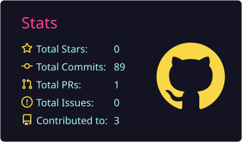
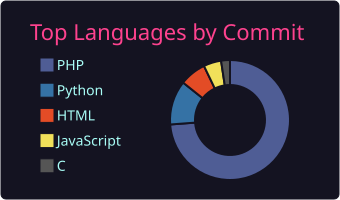

# Hi, I'm Amine 👋

Cybersecurity engineer from Algiers, Algeria — Master's in Information Systems Security (USTHB).

## About me

- 🎓 Master's in Information Systems Security (SSI) — USTHB, Algiers
- 🔐 Working in cybersecurity
- 🔧 Building web apps with PHP / Laravel
- 🛒 Running e-commerce projects (Shopify, Lightfunnels, COD)
- 🐧 Comfortable with Linux, Bash, Git and Docker
- 🌍 Open to remote collaboration and international opportunities

## 🧰 Languages and Tools

  

## 📈 GitHub Stats

  
  
  

